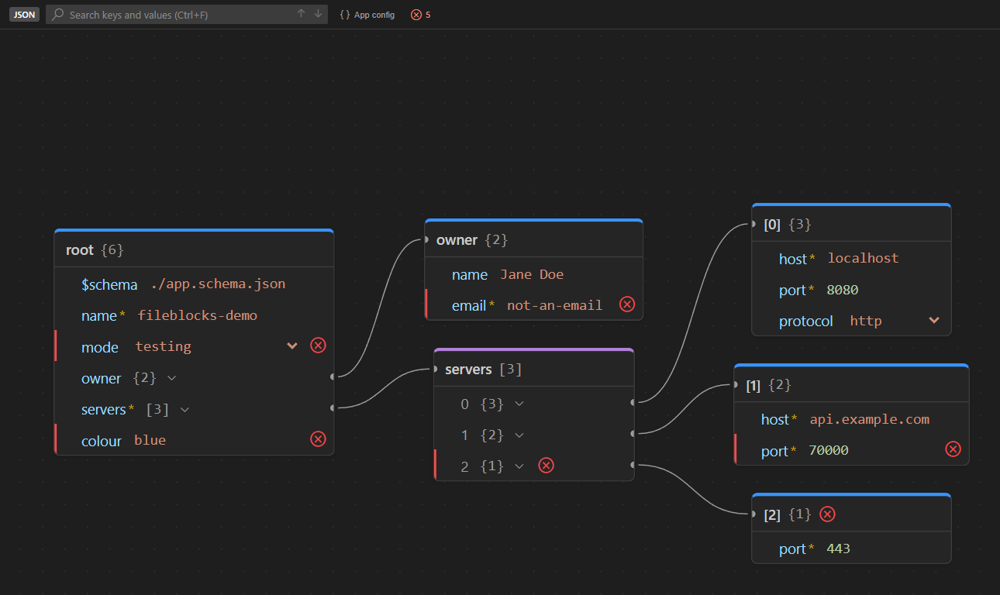
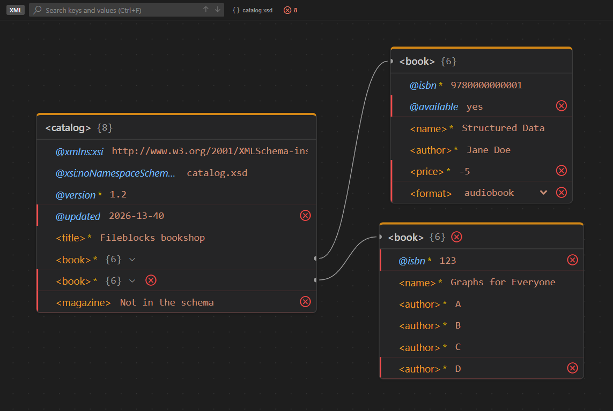

# Fileblocks

[](https://marketplace.visualstudio.com/items?itemName=alessandrovoliveira.fileblocks)
[](https://github.com/AlessandroVOliveira/Fileblocks/releases)
[](LICENSE)

**See and edit structured files as a graph, right inside VS Code.**

Fileblocks opens JSON, YAML, TOML, XML and HTML files as an interactive node graph, in the spirit of
[JSON Crack](https://jsoncrack.com), but fully editable: change values, add, rename, remove and reorder
entries directly on the cards. Every change is written back to the file as a minimal text edit, so your
formatting, comments and layout are preserved, and **Ctrl+Z** undoes anything.



## Features

- **Graph view** of objects, arrays and elements, with automatic layout, pan, zoom and a minimap.
- **Edit in place**: values (checkbox for booleans, dropdown for enums), add entries, rename keys,
  remove, reorder by drag & drop or <kbd>Alt</kbd>+<kbd>↑</kbd>/<kbd>↓</kbd>, and change a value's type.
- **Formatting is kept**: inline arrays stay inline, comments stay where they are, YAML quoting and
  anchors survive, XML entities are escaped only where you edited.
- **Search** keys and values (<kbd>Ctrl</kbd>+<kbd>F</kbd>): matches are highlighted and the canvas
  centers on each one, expanding collapsed nodes.
- **Text and graph in sync**: click a key to select it in the text editor; move the cursor in the text
  and the matching node lights up in the graph.
- **Schema validation and hints**:
  - JSON Schema for JSON, YAML and TOML (from `$schema`, the `yaml-language-server` modeline, Taplo's
    `#:schema`, or the `json.schemas` / `yaml.schemas` settings);
  - XSD and DTD for XML (from `xsi:schemaLocation`, `<!DOCTYPE>`, or `xml.fileAssociations`);
  - or pick one per file with **Fileblocks: Select Schema…**.

  Problems are marked on the cards and counted in the toolbar; required keys get a `*`, descriptions
  show as tooltips, enums become dropdowns, and **+** suggests the properties the schema defines.
- **Large files**: deep levels start collapsed, and only the visible cards and rows are rendered.
- **Export** the whole graph as PNG or SVG.



## Getting started

Install **Fileblocks** from the
[VS Code Marketplace](https://marketplace.visualstudio.com/items?itemName=alessandrovoliveira.fileblocks)
(or search for "Fileblocks" in the Extensions view), or from the command line:

```sh
code --install-extension alessandrovoliveira.fileblocks
```

Then:

1. Open a `.json`, `.jsonc`, `.yaml`, `.yml`, `.toml`, `.xml`, `.html` or `.htm` file.
2. Click the **Open in Block Editor** icon in the editor title bar, or right-click the file in the
   Explorer and choose **Fileblocks: Open in Block Editor**.
3. Use **Open as text** in the toolbar to keep the text editor side by side with the graph.

Fileblocks is registered as an optional editor, so it never replaces your text editor. To always open a
file type with it, use **Reopen Editor With… → Configure default editor**.

## Using the graph

| Action | How |
|---|---|
| Navigate | Drag the background to pan, mouse wheel to zoom, minimap and controls in the corner |
| Edit a value | Click it, type, press <kbd>Enter</kbd> (<kbd>Esc</kbd> cancels) |
| Add | **+** on a card (with a schema, its properties are suggested first) |
| Rename | Double-click a key, or the pencil button |
| Remove | The × button on a row or card |
| Reorder | Drag a row by its handle, or <kbd>Alt</kbd>+<kbd>↑</kbd>/<kbd>↓</kbd> |
| Change type | The ⇄ button (for example `"8080"` → `8080`) |
| Collapse / expand | Click a row's `{n}` / `[n]` summary, or the toolbar buttons for everything |
| Show in text | Click a key or a card title |
| Search | <kbd>Ctrl</kbd>+<kbd>F</kbd>, then <kbd>Enter</kbd> / <kbd>Shift</kbd>+<kbd>Enter</kbd> |
| Schema problems | Click the problem count in the toolbar to jump to the next one |

## Formats

| Format | Notes |
|---|---|
| JSON / JSONC | Comments and trailing commas are supported. |
| YAML | Comments, anchors and quoting are preserved; multi-document files show one card per document. |
| TOML | Tables, dotted keys, inline tables and arrays, and arrays of tables. |
| XML | Elements are cards, attributes are `@name` rows, text is `#text`; text-only elements are shown inline. |
| HTML | Same as XML, with HTML rules: implied end tags, void elements, unquoted and valueless attributes. |

## Commands

| Command | Description |
|---|---|
| **Fileblocks: Open in Block Editor** | Opens the current file as a graph. |
| **Fileblocks: Select Schema…** | Chooses a schema file or URL for the current file, or turns schema checking off. |
| **Fileblocks: Export Graph as Image…** | Saves the whole graph as PNG or SVG. |

## Settings it reads

Fileblocks has no settings of its own; it reuses the ones you may already have:
`json.schemas`, `json.schemaDownload.enable`, `yaml.schemas` and `xml.fileAssociations`.

## Known limitations

- XSD support is a practical subset: element order inside a `sequence`, namespaces and identity
  constraints are not checked. DTD external parameter entities are not loaded.
- In TOML, objects that only exist through dotted keys (`a.b = 1`) can't receive new keys from the graph.
- Exporting a very large graph as PNG is slow and reduced in resolution; prefer SVG for those.

## Feedback

Bugs and ideas are welcome on [GitHub](https://github.com/AlessandroVOliveira/Fileblocks/issues).
See [CONTRIBUTING.md](CONTRIBUTING.md) for how the extension is built (in Portuguese).

## License

[MIT](LICENSE)
